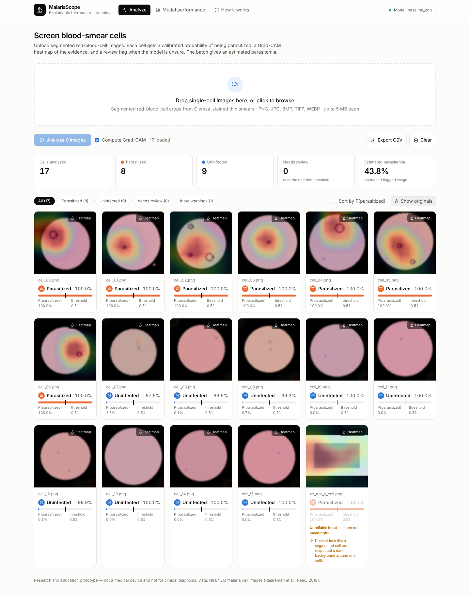
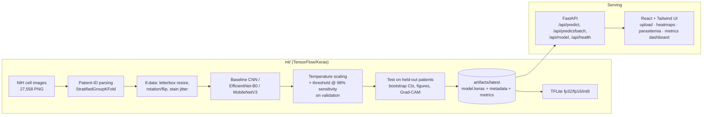

# MalariaScope

**Explainable, calibrated deep-learning screening of malaria parasites in thin blood-smear cell images**, with a leakage-free evaluation protocol, a FastAPI inference service and a React/Tailwind web app.

`TensorFlow/Keras` · `EfficientNet-B0` · `scikit-learn` · `Grad-CAM` · `TFLite` · `FastAPI` · `React + TypeScript + Tailwind` · `Docker` · `GitHub Actions`


<sub>Screenshot from the pipeline smoke test (synthetic look-alike cells). Replace it with one from your real model after training.</sub>

---

## Why this project is different from the usual "malaria CNN"

Most malaria-classifier repos split the NIH dataset randomly **by cell** and report ~97–99% accuracy. Each of the ~200 patients contributes 100+ near-identical cells (same slide, stain and microscope), so a random split puts the *same patient* in train and test, and the score is inflated. The dataset's authors report **98.61% cell-level vs 95.90% patient-level** accuracy for the same family of models (Rajaraman et al., 2018).

MalariaScope is built around doing that properly:

| | Typical project | MalariaScope |
|---|---|---|
| Split | random cells (leaky) | **patient-level** `StratifiedGroupKFold`, asserted zero overlap, plus a cell-split **ablation** to measure the inflation |
| Model | one CNN | from-scratch **CNN baseline** → **EfficientNet-B0** transfer learning (2-phase fine-tuning) → **MobileNetV3** edge model |
| Output | argmax label | **temperature-calibrated** probability (ECE before/after) |
| Threshold | 0.5 | chosen on validation for **≥98% sensitivity** (screening: missing an infection is worse than a false alarm), plus a **"needs review"** band |
| Metrics | accuracy | accuracy, sensitivity, specificity, F1, MCC, ROC-AUC, PR-AUC, with **95% CIs from a patient-level bootstrap** |
| Explainability | — | **Grad-CAM** per prediction in the UI + an error-analysis gallery (FN/FP/TP/TN) |
| Robustness | — | stain-colour augmentation, **out-of-distribution input checks** (flagged images excluded from parasitemia) |
| Deployment | notebook | FastAPI service, React app, Docker Compose, CI, **TFLite fp32/fp16/int8** with size/latency/agreement benchmark |
| Train/serve skew | common | one shared preprocessing function; pixel scaling lives inside the model graph |

## Results

> **Fill this table from your own training run.** The numbers come from `artifacts/runs/<run>/metrics.json` and are printed at the end of training. Do not copy numbers from papers or other repos.

Test set = held-out **patients** (never seen in training or threshold selection). Operating threshold chosen on validation.

| Model | Split | Accuracy | Sensitivity | Specificity | F1 | ROC-AUC | Params |
|---|---|---|---|---|---|---|---|
| Baseline CNN (from scratch) | patient | — | — | — | — | — | 1.18 M |
| **EfficientNet-B0 (transfer, 224 px)** | patient | — | — | — | — | — | 4.05 M |
| EfficientNet-B0 (ablation) | **cell (leaky)** | — | — | — | — | — | 4.05 M |
| MobileNetV3-Small (edge, 128 px) | patient | — | — | — | — | — | 0.94 M |

Calibration (EfficientNet-B0): ECE **— → —** after temperature scaling (T = —).
Edge export (`export_report.json`): int8 TFLite **— MB**, **— ms/cell** on 1 CPU thread, **—%** label agreement with the Keras model.

Figures are generated automatically in `artifacts/runs/<run>/figures/`: confusion matrix, ROC, PR, reliability diagram, training curves, Grad-CAM gallery.

## Architecture



## Quick start

**Requirements:** Python 3.10–3.12 (TensorFlow), Node 20+. A GPU is optional for inference but strongly recommended for training. Use the Colab notebook if you don't have one.

```bash
git clone https://github.com/aryanxwork/malariascope.git && cd malariascope
python -m venv .venv && source .venv/bin/activate        # Windows: .venv\Scripts\activate
pip install tensorflow                                    # or tensorflow-cpu
pip install -e "ml[train,dev]" -r backend/requirements-dev.txt
cd frontend && npm install && cd ..
```

### 1. Get the data
```bash
cd ml
python scripts/download_data.py --out data                # NIH/NLM official zip (~337 MB)
# fallback: kaggle datasets download -d iarunava/cell-images-for-detecting-malaria -p data --unzip
```

### 2. Train (≈20–30 min on a Colab T4 for EfficientNet-B0)
```bash
python -m malariascope.train --config configs/baseline_cnn.yaml     --data-dir data --output-dir ../artifacts/baseline
python -m malariascope.train --config configs/efficientnet_b0.yaml  --data-dir data --output-dir ../artifacts
python -m malariascope.train --config configs/ablation_cell_split.yaml --data-dir data --output-dir ../artifacts/ablation
python -m malariascope.export --model-dir ../artifacts/latest --run-dir ../artifacts/runs/<run>   # TFLite + benchmark
```
No GPU? Open **`notebooks/train_colab.ipynb`** in Google Colab. It runs all of the above and downloads the artifacts.

Every run writes `artifacts/runs/<run>/` (model, config, splits, per-image test predictions, metrics, figures) and promotes the deployable files to `artifacts/latest/`, which is what the API serves.

### 3. Run the app
```bash
cd backend && uvicorn app.main:app --port 8000         # API + docs at http://localhost:8000/docs
cd frontend && npm run dev                              # UI at http://localhost:5173
```
or everything in containers: `docker compose up --build` → UI on http://localhost:8080.

### Pipeline check without the real data
```bash
cd ml && python scripts/make_synthetic_data.py && python -m malariascope.train --config configs/smoke.yaml --output-dir ../artifacts
```
Synthetic look-alike cells only prove the code runs end to end. Those numbers mean nothing.

## API

| Method | Path | Description |
|---|---|---|
| `GET` | `/api/health` | liveness + which model/run is loaded |
| `GET` | `/api/model` | metadata (threshold, temperature, …) and full evaluation metrics |
| `POST` | `/api/predict?gradcam=true` | one image → label, calibrated probability, confidence, needs-review flag, input warnings, Grad-CAM PNG |
| `POST` | `/api/predict/batch?gradcam=true` | up to 64 images → per-image results, per-file errors, summary with estimated parasitemia |

```bash
curl -F "file=@cell.png" "http://localhost:8000/api/predict?gradcam=false"
```
```json
{"filename":"cell.png","label":"Parasitized","probability_parasitized":0.973,"confidence":0.973,
 "threshold":0.31,"needs_review":false,"warnings":[],"gradcam_png":null,"latency_ms":6.2}
```
Validation: 5 MB per-file limit (413), non-images rejected (415), unreadable files reported per-file in batch mode, 503 with a clear message if no model is loaded.

## Repository layout
```
ml/
  malariascope/        data.py (patient split, tf.data) · models.py · train.py · evaluate.py
                       calibration.py · metrics.py · gradcam.py · export.py · plots.py
  configs/             baseline_cnn · efficientnet_b0 · mobilenet_v3_small · ablation_cell_split · smoke
  scripts/             download_data.py · make_synthetic_data.py
  tests/               split leakage, patient-ID parsing, metrics, calibration, Grad-CAM
backend/app/           FastAPI service (main, inference, schemas, settings) + tests/
frontend/src/          React + TS + Tailwind: Analyze, Model performance, How it works
notebooks/             train_colab.ipynb
docs/                  MODEL_CARD.md · screenshots
```

## Tests
```bash
cd ml && pytest -q          # 15 tests: no patient leakage, deterministic splits, metrics, calibration, Grad-CAM
cd backend && pytest -q     # 12 tests: endpoints, validation, OOD flags, batch errors, missing model
```
CI (GitHub Actions) runs both suites, an end-to-end smoke training run, and the frontend build.

## Design decisions
- **Logit output + temperature scaling.** The model outputs a raw logit, so calibration is a single scalar fitted on validation. Ranking (AUC) is unchanged; probabilities become trustworthy. T is bounded to [0.5, 10] so a perfectly separated validation set can't make the probabilities infinitely sharp.
- **Threshold placement.** Among thresholds giving the same validation sensitivity and specificity, the midpoint of that range is used, not its edge. That leaves margin for new patients.
- **BatchNorm.** Backbone BN stays in inference mode during fine-tuning. The baseline uses BN momentum 0.9 so validation scores are meaningful from the first epoch, which matters because early stopping depends on them.
- **Input size.** EfficientNet-B0 runs at 224 px (7×7 last feature map, matching its ImageNet pretraining); at 128 px Grad-CAM would be a coarse 4×4. The from-scratch baseline uses 128 px (16×16 map). The tf.data cache is stored as uint8. With <12 GB RAM at 224 px, set `cache: false`.
- **Grad-CAM always explains the "parasitized" score.** Overlay opacity scales with the probability, so a confidently negative cell doesn't show an amplified noise heatmap.
- **Parasitemia** = parasitized ÷ analyzed cells, excluding images that fail input checks.

## Limitations (read before claiming anything)
- One public dataset, one hospital (Chittagong, Bangladesh), *P. falciparum* only, **pre-segmented** cells. Generalisation to other sites, stains, species or smartphone-microscope images is untested.
- It classifies single cells. It does not segment whole fields of view, stage parasites, or diagnose patients.
- Some labels in this dataset are known to be noisy.
- The OOD check is a heuristic for obvious misuse, not a guarantee.
- **Not a medical device.** For research and education only.

## References
- Rajaraman S. et al. *Pre-trained convolutional neural networks as feature extractors toward improved malaria parasite detection in thin blood smear images.* PeerJ 6:e4568 (2018). Dataset: NIH/NLM LHNCBC.
- Selvaraju R. R. et al. *Grad-CAM: Visual explanations from deep networks via gradient-based localization.* ICCV 2017.
- Guo C. et al. *On calibration of modern neural networks.* ICML 2017.
- Tan M., Le Q. *EfficientNet: Rethinking model scaling for CNNs.* ICML 2019.

## License
MIT. Dataset © NIH/NLM, see its terms on the LHNCBC site.
